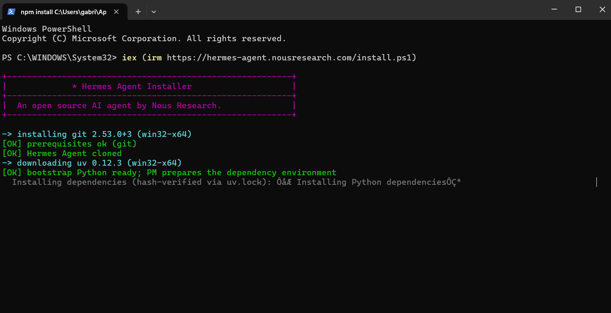
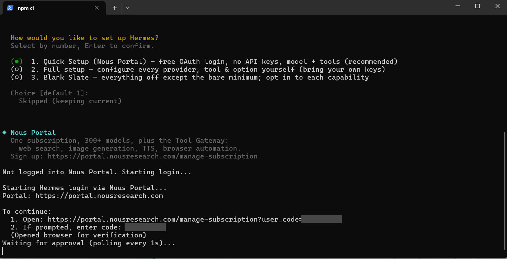
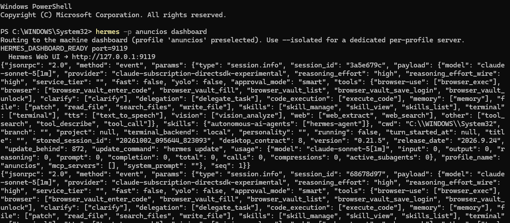
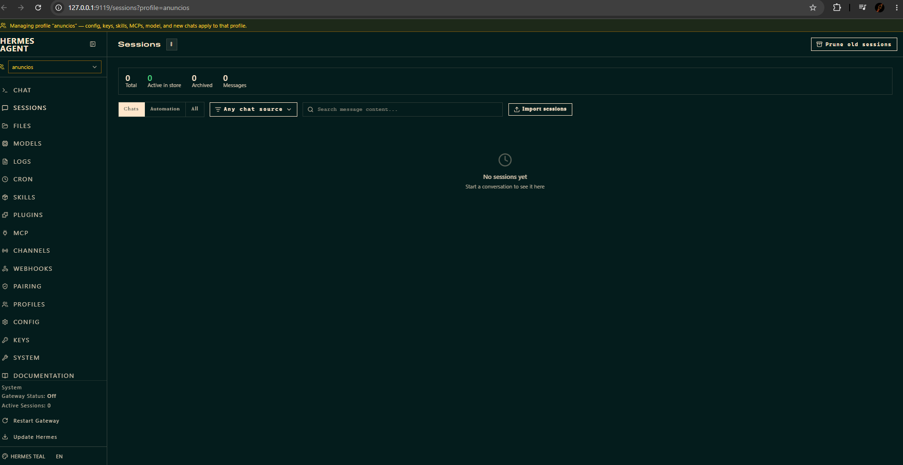
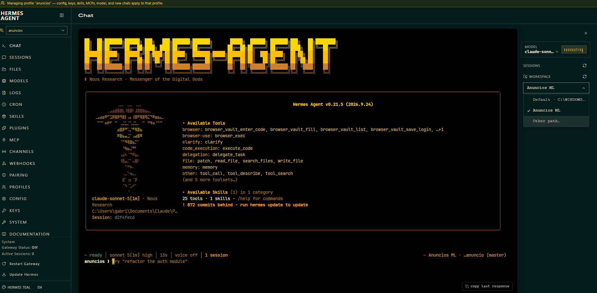

# Hermes — instalar e conectar à assinatura do Claude

Trilha alternativa para conduzir o projeto: em vez do Claude Code ou do Codex, o agente é o
**Hermes Agent**, usando o Claude pela sua assinatura. O projeto não muda; só muda quem conversa
com você.

> **Status: em teste.** Os passos 1 a 9 foram feitos e conferidos entre 30/09 e 02/10/2026, num
> Windows 11, com Hermes v0.21.5 e o plugin `claude-subscription-directsdk` (versão fixada
> `ef73726c`). Em 03/10/2026 a instalação do app Desktop (passo 10) atualizou o Hermes para
> `v0.21.5+6569` (commit `7533bd2`); o plugin e o chat seguiram funcionando, conferido no app.
> Rodar um produto de ponta a ponta **ainda não foi feito** — veja as
> [pendências](#pendências-ainda-não-validado). Não grave aula antes de fechá-las.

## Por que testar o Hermes

O que motivou o teste, e o que ficou combinado:

- **Skills que o agente cria e melhora.** O Hermes aprende com o uso e guarda isso como skill. A
  ideia é ele se aprimorar conforme o operador traz pontos de melhoria, não executar tudo sozinho.
- **Assinatura do Claude, sem API.** Um plugin oficial (experimental) da Nous Research faz o Hermes
  usar o login do Claude Code, sem API key e sem cobrança por token.
- **Os checkpoints humanos continuam.** Confirmar a semântica, revisar imagens, escolher o catálogo
  e revisar o anúncio antes de publicar seguem valendo, assim como o OK antes de gastar crédito com
  imagem.
- **Avaliações, busca e anúncio de concorrente.** O navegador do Hermes é bloqueado pelo ML. O
  caminho são os comandos `ml:busca`, `ml:sugestoes` e `ml:pagina`, que abrem um Chrome normal com
  perfil separado (resolvido em 06/10/2026).
- **Público:** os alunos da mentoria. A intenção é gravar uma versão 2.0 da aula com essa trilha,
  depois que o teste fechar.

Contrapontos levantados na conversa, e que viraram as pendências abaixo: o plugin é experimental;
cada turno gasta a cota da assinatura; o Hermes só pergunta antes de comandos "perigosos", então a
parada antes de publicar depende das regras do `AGENTS.md`; e skill criada sozinha precisa de
revisão antes de virar regra.

## O que é cada coisa, e onde fica

O Hermes é um **programa instalado no seu computador**, como qualquer outro. O PowerShell só serve
para instalá-lo e abri-lo.

| O quê | Onde |
|---|---|
| Programa Hermes | `%LOCALAPPDATA%\hermes\hermes-agent` |
| Comando `hermes` | `%LOCALAPPDATA%\hermes\bin` (entra no PATH sozinho) |
| Configuração e perfis | `%LOCALAPPDATA%\hermes` e `%LOCALAPPDATA%\hermes\profiles\anuncios` |
| Plugin da assinatura | `...\profiles\anuncios\plugins\claude-subscription-directsdk-experimental` |
| Aplicativo Desktop (passo 10) | `...\hermes-agent\apps\desktop\release\win-unpacked\Hermes.exe`, com atalho **Hermes** na área de trabalho |
| Seu projeto | a pasta onde você baixou o `criacao-anuncio` |
| O modelo (Claude) | nos servidores da Anthropic, acessado pela sua assinatura |

Para ver os arquivos, cole `%LOCALAPPDATA%\hermes` na barra de endereço do Explorador de Arquivos.

O comando e os arquivos rodam **na sua máquina**. O que está na nuvem é só o modelo que responde.

## Antes de começar

- Windows 10 ou 11. O Hermes roda direto no Windows, sem WSL.
- O projeto já instalado, conforme o [manual de instalação](01-INSTALACAO.md).
- **Assinatura Claude Pro ou Max**, com o **Claude Code instalado e logado**. Quem usa só o Codex
  precisa instalar o Claude Code para seguir esta trilha.
- Um **PowerShell normal**. Se o prompt começar com `PS C:\WINDOWS\System32>`, provavelmente é o
  PowerShell como administrador: feche e abra de novo pelo menu Iniciar, sem "Executar como
  administrador". O agente roda comandos, e não deve rodar com poder de administrador.
- Atenção à **cota**: cada turno do Hermes é descontado da cota de Agent SDK da assinatura. No
  plano Pro ela pode acabar rápido. Acompanhe o consumo no primeiro produto.

> Nada de `.env`, `.tokens.json`, `OPERACAO.md`, e-mail ou identificadores da conta em print, chat ou
> vídeo. Vale também para os prints deste material.

## Passo a passo

### Passo 1 — Instalar o Hermes

No PowerShell:

```powershell
iex (irm https://hermes-agent.nousresearch.com/install.ps1)
```

O comando baixa o instalador do site oficial do Hermes, que por sua vez baixa o programa (do
GitHub da Nous Research) e as peças de que ele precisa: Git, Python e componentes extras, como o
navegador interno do agente. Não precisa instalar nada antes. **Leva alguns minutos.**



Os caracteres estranhos na linha "Installing Python dependencies" são só problema de exibição do
terminal; a instalação continua normalmente.

### Passo 2 — Pular o assistente de configuração

No final, o instalador abre um assistente ("How would you like to set up Hermes?"). A opção
padrão, **Quick Setup**, abre o navegador para um login no **Nous Portal**. Esse não é o nosso
caminho: usamos a assinatura do Claude, e **não é preciso criar conta na Nous**.



O que fazer:

1. **Feche a aba** do navegador, sem aprovar nada.
2. No terminal, aperte **Ctrl+C** uma vez.
3. O assistente segue com algumas perguntas. No "Terminal Backend", mantenha **Local** (a opção
   "Keep current (local)"): é o que faz o Hermes rodar direto no seu computador. Na pergunta sobre
   plataformas de mensagem (Telegram, Discord), pule. Na pergunta "Start the gateway now after
   install?", responda `n`. No nosso teste, cancelamos com Ctrl+C e o Hermes ficou instalado.

A mensagem "Setup cancelled. Remaining sections were not changed." é esperada. Depois, **feche o
PowerShell e abra um novo**: o comando `hermes` só é reconhecido em terminal aberto depois da
instalação.

### Passo 3 — Conferir o Hermes

```powershell
hermes --version
```

Deve aparecer algo como `Hermes Agent v0.21.5` e `Up to date`. O plugin exige versão **0.21.4 ou
mais nova**. (Depois de instalar o app Desktop do passo 10, a versão passa a aparecer como
`v0.21.5+6569.g7533bd2`.)

### Passo 4 — Conferir o login do Claude Code

```powershell
claude auth status
```

Procure `"loggedIn": true` e, em `"subscriptionType"`, `pro` ou `max`. A saída também mostra e-mail
e identificador da organização: **não cole isso em lugar nenhum**.

- Se não estiver logado: `claude auth login`.
- Se o comando `claude` não existir: `npm install -g @anthropic-ai/claude-code` e depois o login.

### Passo 5 — Criar o perfil `anuncios`

Um perfil é um espaço separado, com configuração e plugin próprios. Assim o Hermes dos anúncios não
se mistura com outros usos.

```powershell
hermes profile create anuncios --no-skills --no-alias
```

- `--no-skills`: o perfil nasce sem as skills de fábrica.
- `--no-alias`: não cria atalho. Por isso, **sempre** use `hermes -p anuncios ...`.

O Hermes vai sugerir comandos como `anuncios setup` e `anuncios chat`, e vai avisar que "este perfil
não tem API keys". Ignore: esses atalhos não existem por causa do `--no-alias`, e o plugin usa o
login do Claude Code, não uma chave.

### Passo 6 — Instalar o plugin da assinatura

```powershell
hermes -p anuncios plugins install claude-subscription-directsdk --enable
```

Vai aparecer a descrição do plugin (oficial, mantido pela Nous Research, experimental) e o
download. **Pode levar vários minutos** — no nosso teste, cerca de 7 até a primeira pergunta — e o
terminal fica sem cursor enquanto trabalha. Não aperte Ctrl+C.

Aparece então:

```
Prepare these with Hermes through PM now? [y/N]:
```

Digite **`y`** e Enter. Sem isso o plugin fica instalado, mas desligado. Ao final aparece o quadro
"Installed" e a linha "Plugin ... enabled". A linha "Restart the gateway for the plugin to take
effect" pode ser ignorada: o gateway é só para Telegram e Discord.

### Passo 7 — Escolher o modelo

```powershell
hermes -p anuncios model
```

Na lista de provedores, escolha **"Claude Subscription DirectSDK (Experimental)"**. Na v0.21.5 era
o número 40, mas o número muda: leia o nome. Digite o número e Enter; a opção marcada de início é
o Nous Portal, então **não aperte só Enter**. Não escolha "Anthropic": ela pede API key.

Depois ele pergunta:

- **Modelo padrão:** escolhemos `claude-sonnet-5[1m]`. As opções marcadas "usage credits" (Opus 5.5
  e Fable 5.1 na época) cobram créditos extras além do plano; evite.
- **Esforço de raciocínio:** escolhemos `high`. O padrão é `medium` e gasta menos cota.

### Passo 8 — Abrir o Hermes na pasta do projeto

Entre na pasta onde você baixou o projeto. No terminal, o `cd` é obrigatório: é da pasta atual que o
Hermes lê o `AGENTS.md`.

```powershell
Set-Location $HOME\Documents\criacao-anuncio
```

Duas formas de conversar:

**No terminal:**

```powershell
hermes -p anuncios
```

**Num site local, no navegador (mais amigável para quem não gosta de terminal):**

```powershell
hermes -p anuncios dashboard
```

O endereço padrão é `http://127.0.0.1:9119` (o chat fica em `/chat`). Confie no que aparecer no
terminal, caso a porta seja outra. `127.0.0.1` significa "este computador": ninguém de fora acessa.
A janela do PowerShell precisa ficar **aberta**, porque ela é o servidor. Ela vai se encher de
linhas técnicas (`jsonrpc`, `session.info`...) a cada vez que a página do Chat carrega, e **não dá
para digitar nela**. Isso é normal: ignore, minimize a janela e, para rodar outro comando, abra
outro PowerShell. Você conversa na página do navegador.



#### Conhecendo a tela do dashboard



A faixa amarela no topo e o seletor no canto esquerdo mostram o perfil ativo: deve estar
**`anuncios`**. Tudo que você mudar ali (modelo, chaves, skills) vale para esse perfil.

| Página | Para que serve | Use agora? |
|---|---|---|
| **Chat** | A conversa com o agente. É o mesmo Hermes do terminal, dentro do navegador. | **Sim: é aqui que se trabalha** |
| **Sessions** | Histórico das conversas, com busca e exportação. Começa zerado. | Para consultar depois |
| **Skills** | As skills instaladas, que podem ser ligadas e desligadas. É onde vão aparecer as que o Hermes criar. | Para conferir depois |
| **Logs** | Registros do agente, para diagnosticar erro. | Só se algo falhar |
| **Profiles** | Os perfis (cada um com configuração e conversas próprias). | Não |
| **Config** e **Keys** | Edição de configurações e de chaves de API. | Não mexer por enquanto |
| **Channels**, **Webhooks**, **Pairing** | Conexão com Telegram, Discord e outros. | Não: não usamos |
| **Cron** | Tarefas agendadas. | Não, por enquanto |

A página **Files** é um navegador de arquivos do computador, com envio de arquivos e criação de
pastas: é por ela que você coloca fotos e documentos na pasta do produto (veja
[Mandar texto, links e imagens](#mandar-texto-links-e-imagens-no-chat)). Pelo código do dashboard,
ela abre na pasta do próprio Hermes, então é preciso ir até a pasta do projeto. **Models** e
**Plugins** não aparecem na documentação; ainda não foram exploradas. No rodapé da barra lateral, "Gateway Status: Off" é o
normal. **Não clique em "Update Hermes" durante o teste:** o plugin é experimental e foi testado
primeiro com a versão v0.21.5. (A instalação do app Desktop, passo 10, já atualizou o Hermes uma vez.)

#### Escolher a pasta do projeto no Chat

O Chat abre na pasta de onde o dashboard foi ligado. Se foi ligado de `C:\WINDOWS\System32` (o
prompt de um PowerShell novo), o Hermes trabalha **dentro da pasta do Windows** e não lê o
`AGENTS.md`. Na primeira vez, o seletor de **WORKSPACE** (coluna da direita) só mostra esse
`Default`, mesmo que o projeto exista no computador.

Resolva criando **uma vez** um projeto nomeado, num **segundo** PowerShell (o do dashboard fica
aberto). Troque o caminho se o seu projeto estiver em outra pasta:

```powershell
hermes -p anuncios project create "Anuncios ML" "$HOME\Documents\criacao-anuncio" --use
```

Depois, na página do dashboard:

1. Clique no ícone de recarregar (⟳) ao lado de **WORKSPACE**.
2. Abra a caixa que mostra `Default` e escolha **Anuncios ML**. (A caixa tem também "Other path…",
   para digitar um caminho; não testamos.)
3. Clique em **New chat**.
4. Confira o canto inferior direito do Chat: deve aparecer o nome do projeto e o ramo, como
   `Anuncios ML · …anuncio (master)`. Se aparecer `System32`, está na pasta errada.



A faixa "872 commits behind - run hermes update to update" (o número muda) no quadro de abertura
pode ser ignorada: **não atualize durante o teste.**

### Passo 9 — Teste de leitura

Primeira mensagem, que só lê e não altera nada:

> Leia o AGENTS.md e o OPERACAO.md e me diga as regras que não se negociam e os checkpoints
> humanos. Não execute nenhum comando nem altere arquivos.

Se ele citar a trava de escrita na API, o `--confirmo` das imagens e os checkpoints, o contexto
carregou. Se responder de forma genérica, está fora da pasta do projeto ou não leu o arquivo.

No nosso teste (02/10/2026) ele listou as regras (trava de escrita na API, segredos, preço do
operador, custo das imagens), os 4 checkpoints, informou a pasta certa e **não abriu** `.env` nem
`.tokens.json`. O repositório ficou intacto.

**Teste sem abrir o dashboard (opcional).** Dá para fazer a mesma pergunta pelo terminal, num modo
de uma pergunta só, limitando o agente às ferramentas de arquivo. `pergunta.txt` é um arquivo de
texto com o pedido:

```powershell
hermes -p anuncios chat --oneshot -Q -t file --max-turns 8 --in "$HOME\Documents\criacao-anuncio" --query-file pergunta.txt
```

### Passo 10 — (Opcional) O aplicativo Hermes Desktop

O Chat do dashboard (passo 8) é um terminal dentro do navegador e fica pouco fluido para colar texto
longo e imagens. O **Hermes Desktop** é um aplicativo de janela comum, com caixa de mensagem própria.
Ele usa a mesma pasta `%LOCALAPPDATA%\hermes`, então perfil, plugin, projeto e conversas são os
mesmos.

**Instalar.** Baixe o instalador na [página oficial](https://hermes-agent.nousresearch.com/desktop)
e rode. No nosso teste (03/10/2026) levou cerca de 13 minutos e criou o atalho **Hermes** na área de
trabalho. Atenção: **a instalação atualizou o Hermes junto**, para a versão mais nova do GitHub. Aqui
ele foi de `9cbc6a5ac` (v0.21.5) para `7533bd2` (`v0.21.5+6569`, 1.663 commits depois). O plugin e o
chat continuaram funcionando. Isso está no registro `logs\bootstrap-installer.log` e no histórico do
git da pasta do Hermes.

**Abrir.** Pelo ícone **Hermes** da área de trabalho. Não abra o app de dentro de um terminal ou
programa que defina variáveis `ANTHROPIC_*` (veja "Problemas"): o plugin recusa e o chat dá erro.

**A tela "Let's get you setup with Hermes Agent".** Na abertura pode aparecer uma tela cheia dizendo
"Hermes is not connected to any AI provider yet", com Nous Portal, modelos locais, ChatGPT,
"Anthropic Account" e outros. Ela aparece **mesmo com o plugin funcionando**: o texto cita a pasta
`%LOCALAPPDATA%\hermes` (o perfil padrão, onde nunca configuramos nada), e o chat do perfil
`anuncios` responde normalmente. Clique em **"I'll choose a provider later"**, no canto inferior
esquerdo, em letra pequena. Isso só dispensa o aviso e não muda configuração. Ela voltou numa abertura
seguinte, nesta máquina: é só clicar de novo.

Não escolha nenhum dos cartões. Em especial **"Anthropic Account"**, que parece ser a sua conta do
Claude, mas é o login do próprio Hermes nela (`hermes auth add anthropic`). Na lista de contas do
Hermes, o login por OAuth da Anthropic aparece rotulado "Required Extra Usage Credits to Use
Subscription", e um comentário no código diz que não há botão de conectar na tela de propósito,
porque isso geraria tokens da assinatura fora do programa da Anthropic, contra as regras de OAuth
dela (arquivo `hermes_cli/web_server_oauth.py`). O plugin do passo 6 faz outra coisa: o Hermes chama
o programa `claude` oficial, já logado, e nunca toca nas credenciais. Ainda assim, o README do plugin
lembra que "extra usage" é configuração da conta: desligue lá se não quiser cobrança além da
assinatura.

**Entrar no projeto.** Uma conversa nova fora de um projeto abre na sua pasta de usuário (o rodapé
mostra `gabri`, por exemplo) e o Hermes **não lê o `AGENTS.md`**: é o mesmo problema do `System32` no
dashboard. Para entrar no projeto criado no passo 8:

1. Aperte **Ctrl+K** e digite `Anuncios`.
2. Clique em **Anuncios ML**. A barra lateral passa a mostrar só as conversas do projeto.
3. Clique em **New session**. O rodapé deve mostrar o nome do projeto (`Anuncios ML` ou o nome da
   pasta, `criacao-anuncio`).

**Teste (03/10/2026).** Numa conversa nova dentro do projeto, "Responda somente com a palavra ok."
voltou `ok` em cerca de 4 segundos. A pergunta "qual é a primeira regra que não se negocia no
AGENTS.md?" voltou a regra certa (nunca escrever na API do Mercado Livre sem confirmação explícita do
operador). Ou seja: o app conversa pelo Claude e lê o contexto do projeto.

**Ainda não testado no app:** colar imagem com Ctrl+V, colar texto longo e anexar arquivo. Pelo
código, a caixa de mensagem tem miniaturas de anexo, mas não conferimos na tela. O aviso "Help improve
Hermes?" pergunta se você quer enviar contadores de uso à Nous; a escolha é sua e não clicamos em
nenhuma opção.

## Mandar texto, links e imagens no Chat

> Esta tabela vale para o Chat do dashboard e do terminal. No app Desktop (passo 10) a caixa de
> mensagem é outra, e colar imagem ou texto longo ainda não foi testado lá.

| O que você manda | Funciona? | Como fazer |
|---|---|---|
| Texto | Sim | Cole na linha `anuncios ❯`. Dados de ferramentas de pesquisa entram assim, como texto. Um texto longo vira um marcador entre colchetes duplos, como `[[ ... [14 lines] ... ]]`: é normal, o texto inteiro vai quando você apertar Enter. |
| Links do Mercado Livre | Esperado, ainda não validado | Cole os links. O `AGENTS.md` manda passá-los ao script `ml:referencia`, que busca pela API do ML. |
| Links de outros sites | **Não, sem configurar** | Testado em 02/10/2026: a leitura de páginas do Hermes falhou e pediu uma chave do Firecrawl (`FIRECRAWL_API_KEY`). Cole o texto da página no lugar do link. |
| Imagens, para ele **olhar** | Sim, com cuidado | Cole com Ctrl+V ou arraste a imagem para a área do Chat: o dashboard envia o arquivo, digita `/image caminho` e dá Enter **sozinho**. **Faça isso com a caixa vazia, antes de escrever o texto.** Se já houver texto, tudo é enviado na hora, com o `/image` colado no fim, e a imagem não é anexada (testado em 02/10/2026). Para várias imagens, repita com a caixa vazia ou arraste vários arquivos de uma vez (pelo código; não testado). Testado pelo terminal: ele leu o rótulo de uma foto de produto. |
| Arquivos que o fluxo precisa **ler do disco** (foto base, PDF, planilha) | Sim, pela página Files | Menu **FILES**, vá até a pasta do produto (`produtos/<slug>/base/`) e envie o arquivo, pelo botão ou arrastando. Depois diga o caminho ao Hermes. Ainda não testado na tela; PDF e planilha também não foram testados para leitura. |

Para a **foto base** do produto, não basta anexar no Chat: a imagem anexada fica na pasta do
Hermes, e o fluxo lê o arquivo de `produtos/<slug>/base/`. Envie a foto pela página **Files** para
essa pasta e diga o caminho ao Hermes.

Chaves nunca vão no chat: se um dia configurar o Firecrawl, cole a chave direto no arquivo `.env`
do perfil, no seu editor.

### O que aparece enquanto ele trabalha

Cada ação do Hermes aparece com o nome da ferramenta que ele usou:

| Nome | O que faz | Muda algo? |
|---|---|---|
| `search_files`, `read_file`, `skills_list`, `skill_view` | Procurar e ler arquivos e skills | Não |
| `write_file`, `patch` | Criar ou editar arquivos | **Sim** |
| `terminal`, `execute_code` | Rodar um comando ou código (por exemplo `npm run ...`) | **Sim** |
| `skill_manage`, `memory` | Criar ou editar skills e guardar lembranças entre conversas | **Sim** (no Hermes) |
| `clarify` | Fazer uma pergunta para você | Não |
| `delegate_task` | Passar uma tarefa a outro agente | Depende |
| `web_search`, `web_extract`, `browser_*` | Internet e navegador do agente | Precisa de configuração |
| `vision_analyze` | Olhar uma imagem | Não |

## Tirar dúvidas com o próprio Hermes

Dá para perguntar ao Hermes, no próprio Chat, como usar o Hermes. Ele já traz uma skill sobre si
mesmo (`hermes-agent`) e, estando na pasta do projeto, consegue ler este manual. No teste de
02/10/2026, perguntado sem nenhuma dica sobre como anexar mais de uma imagem, ele achou a resposta
neste manual e avisou o que não tinha certeza.

- Para só ouvir a explicação, termine a pergunta com "só explique, não altere nada".
- O comando `/help` no Chat lista os comandos, sem gastar a cota da assinatura. Cada pergunta ao
  agente gasta um turno.
- Confira respostas sobre telas e botões com este manual, que marca o que foi testado e o que veio
  só do código. O Hermes pode resumir de forma imprecisa.

## Como o Hermes trata as regras do projeto

- **Contexto.** O Hermes procura, na pasta atual e subindo até a raiz do Git, `.hermes.md`,
  `AGENTS.override.md`, `AGENTS.md`, `CLAUDE.md` e `.cursorrules`, e usa o **primeiro que
  encontrar**. Aqui é o `AGENTS.md`, igual ao `CLAUDE.md`.
- **Aprovação de comandos.** O Hermes só pergunta antes de comandos que considera perigosos (apagar
  pastas, formatar disco, `curl | sh` etc.). Comandos normais como `npm run ...` e `node ...` rodam
  **sem perguntar**, em qualquer modo (`smart`, `manual` ou `off`). Não existe configuração para
  mandar o Hermes perguntar antes de um comando específico; só para **bloquear** de vez
  (`approvals.deny`).
- **O que isso significa para o método.** A parada antes de publicar, o OK antes de gastar crédito
  com imagem e os checkpoints humanos funcionam porque (1) o `AGENTS.md` manda o agente parar e
  (2) os scripts exigem `--confirmo`. A trava de escrita da API fica no código
  (`scripts/ml/api.js`) e vale em qualquer ferramenta. Se algum dia for preciso uma trava que não
  dependa do agente obedecer, dá para bloquear o comando de publicação no `approvals.deny`; assim
  ele prepara tudo e o operador roda o último comando. **Ainda não configurado nem testado.**

## Problemas que apareceram

| O que você vê | O que é | O que fazer |
|---|---|---|
| "Not logged into Nous Portal. Starting login..." e abre o navegador | O Quick Setup usa o login da Nous | Feche a aba e aperte Ctrl+C (passo 2) |
| Terminal sem cursor depois do comando do plugin | Está baixando, ou esperando uma pergunta de sim/não | Olhe as últimas linhas; se houver `[y/N]`, responda `y` |
| `anuncios setup` ou `anuncios chat` não funcionam | O perfil foi criado com `--no-alias` | Use `hermes -p anuncios ...` |
| "Restart the gateway for the plugin to take effect" | Aviso do gateway de mensagens | Ignore |
| "This profile has no API keys yet" | O plugin usa o login do Claude Code | Ignore |
| `hermes` não é reconhecido | O terminal foi aberto antes da instalação | Feche e abra um PowerShell novo |
| Prompt `PS C:\WINDOWS\System32>` | Provável PowerShell como administrador | Feche e abra um normal |
| A janela do dashboard enche de linhas `jsonrpc` e não aceita digitação | É o registro do servidor | Ignore e minimize; use outro PowerShell para comandos |
| O Chat mostra `System32` no canto inferior direito | O dashboard foi ligado de lá | Crie o projeto e escolha-o em WORKSPACE (passo 8) |
| Colei uma imagem e a mensagem foi enviada na hora, com `/image C:\...` grudado no fim do texto | A colagem de imagem dá Enter sozinha, e a caixa já tinha texto | Cole a imagem com a caixa vazia, antes de escrever o texto |
| `Your request was not processed. Send it again if you still want me to carry it out.` | O envio foi interrompido (Esc, Ctrl+C ou parar); o Hermes não fez nada | Envie a mensagem de novo |
| `rejected the request` e `refuses conflicting native auth/backend overrides: ANTHROPIC_BASE_URL` | O terminal tem variáveis `ANTHROPIC_*` definidas, comum ao rodar de dentro de outro app que usa o Claude | Abra um PowerShell novo e normal, ou remova a variável só nessa janela: `Remove-Item Env:ANTHROPIC_BASE_URL` |
| No app Desktop: "The AI service returned an error", e nos detalhes o mesmo `refuses conflicting native auth/backend overrides: ANTHROPIC_BASE_URL` | O app foi aberto de dentro de um terminal ou programa que define `ANTHROPIC_*`, e o motor do app herdou isso (aconteceu no teste de 03/10/2026) | Feche o app e abra pelo ícone **Hermes** da área de trabalho |
| No app Desktop: tela "Let's get you setup with Hermes Agent" / "not connected to any AI provider yet" | O aviso cita a pasta do perfil padrão, que não tem provedor; o perfil `anuncios` está configurado | Clique em "I'll choose a provider later" (passo 10). Não escolha "Anthropic Account" |
| No app Desktop, o rodapé mostra a pasta do usuário (por exemplo `gabri`) e não o projeto | A conversa nova foi aberta fora do projeto, então o `AGENTS.md` não é lido | Ctrl+K, escolha **Anuncios ML** e clique em **New session** |

## Pendências (ainda não validado)

- [x] Teste de leitura do passo 9 (02/10/2026): o Hermes leu `AGENTS.md` e `OPERACAO.md`, citou
  regras e checkpoints, estava na pasta certa e não alterou nada. Feito pelo terminal; falta
  repetir na aba Chat do dashboard.
- [x] App Desktop (03/10/2026): abre, conversa pelo Claude e lê o `AGENTS.md` do projeto. Falta
  testar nele colar imagem (Ctrl+V), texto longo e anexos.
- [ ] Decidir se os alunos usam só o perfil padrão, sem criar o `anuncios`: talvez evite a tela
  "not connected to any AI provider" do Desktop. Não testado.
- [ ] Conferir o plugin e o fluxo depois da atualização do Hermes de 03/10 (+1.663 commits): o "ok" e
  a leitura do `AGENTS.md` passaram; o resto não foi repetido.
- [x] Rodar um produto real de ponta a ponta no Hermes: um produto publicado em 06/10/2026.
  Achados no `PENTE-FINO.md` do produto (pasta local).
- [ ] Medir o consumo da cota num produto completo, no plano Pro.
- [x] Fluxo de duas paradas (imagens e final), com a ficha completa pedida no início, gravado no
  `OPERACAO.md` do mantenedor e conferido: o Hermes descreveu o fluxo certo. Falta decidir como
  ensinar os alunos a gravar o deles.
- [ ] Decidir se vale a trava dura de publicação (`approvals.deny`).
- [x] Substituto do Claude in Chrome: o `browser_exec` do Hermes foi testado e é bloqueado pelo ML.
  Viraram comandos do projeto (`ml:busca`, `ml:sugestoes`, `ml:pagina`) com Chrome normal.
- [ ] Ver onde ficam as skills que o Hermes cria e definir como revisá-las e promovê-las para
  `docs/` ou `OPERACAO.md`.
- [ ] Registrar nos termos oficiais da Anthropic que usar a assinatura por essa via é suportado,
  antes de ensinar isso a terceiros.
- [ ] Repetir este passo a passo numa máquina limpa antes de gravar a aula.

## Fontes

- [Plugin Claude Subscription DirectSDK](https://hermes-agent.nousresearch.com/docs/plugins/claude-subscription-directsdk)
- [Hermes Desktop (instalador oficial)](https://hermes-agent.nousresearch.com/desktop)
- [Hermes no Windows (instalação nativa)](https://github.com/nousresearch/hermes-agent/blob/main/website/docs/user-guide/windows-native.md)
- [Arquivos de contexto](https://hermes-agent.nousresearch.com/docs/user-guide/features/context-files)
- [Segurança e aprovação de comandos](https://hermes-agent.nousresearch.com/docs/user-guide/security)
- [Quickstart](https://hermes-agent.nousresearch.com/docs/getting-started/quickstart)
